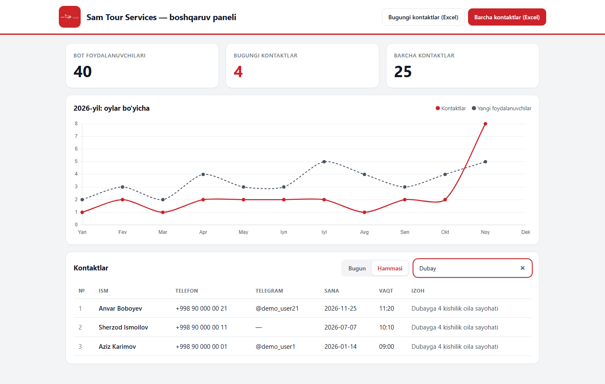
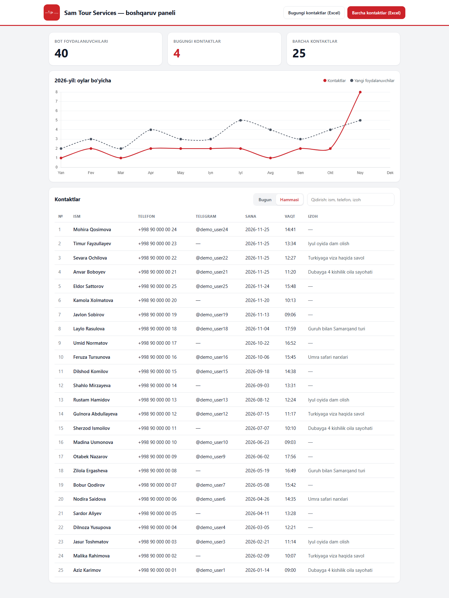
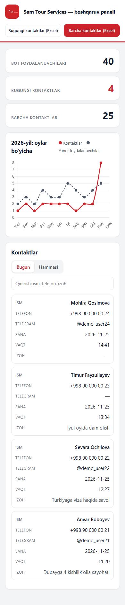

<div align="center">


# Sam Tour Services

**Sayohat agentligi uchun Telegram bot va boshqaruv paneli: mijoz kontaktini yig'adi, adminlar guruhiga yuboradi, hisobotni Excel'da beradi.**


[Panel](#boshqaruv-paneli) · [Bot](#bot-qanday-ishlaydi) · [O'rnatish](#ornatish) · [Sozlamalar](#sozlamalar) · [Sahifa](https://abduazizbobomalikovnode.github.io/Sam-Tour-Services/)



</div>

> [!NOTE]
> Barcha screenshotlardagi ism, telefon va username'lar o'ylab topilgan demo ma'lumot (`+998 90 000 00 xx`, `@demo_user…`). Haqiqiy mijoz ma'lumoti repoda saqlanmaydi.

---

## Boshqaruv paneli

`npm start` dan keyin `http://localhost:8080` da ochiladi. Login va parol bilan himoyalangan.

<table>
<tr>
<td width="72%"></td>
<td width="28%"></td>
</tr>
<tr>
<td align="center"><sub>Kompyuterda: barcha kontaktlar</sub></td>
<td align="center"><sub>Telefonda: jadval kartalarga aylanadi</sub></td>
</tr>
</table>

| Qism | Nima ko'rsatadi |
|---|---|
| KPI kartalar | Bot foydalanuvchilari, bugungi kontaktlar, jami kontaktlar |
| Grafik | Joriy yil oylari bo'yicha kontaktlar va yangi foydalanuvchilar (Chart.js, lokal fayldan — CDN'siz) |
| Jadval | Ism, telefon, Telegram, sana, vaqt, izoh. **Bugun / Hammasi** tablari va ism, telefon yoki izoh bo'yicha qidiruv |
| Excel tugmalari | Bugungi yoki barcha kontaktlarni `.xlsx` qilib yuklab beradi |

Panel faqat `PANEL_PASSWORD` berilganda ishlaydi. Parol bo'lmasa har bir sahifa `503` qaytaradi, mijoz ma'lumoti hech qachon parolsiz ko'rsatilmaydi. Login vaqt bo'yicha xavfsiz usulda (timing-safe) taqqoslanadi.

## Bot qanday ishlaydi

```
Mijoz  /start
  ├─ 📝 Рўйхатдан ўтиш ─► telefon ─► ism ─► izoh (ixtiyoriy) ─► 🔚 Якунлаш
  │                                                     │
  │                                    MongoDB ◄────────┤
  │                                                     └─► adminlar guruhiga "#<id> · yangi kontakt"
  └─ 👨🏻‍💻 Биз ҳақимизда ─► logo + agentlik manzili va telefonlari
```

**Mijoz uchun** (o'zbek kirill):

| Qadam | Bot nima qiladi |
|---|---|
| Telefon | Yozilgan yoki "☎️ Телефон рақамни улашиш" tugmasi bilan yuborilgan raqamni qabul qiladi. Faqat `+998` raqamlar o'tadi |
| Ism | Harflar bilan bo'lishi kerak, 60 belgigacha |
| Izoh | Ixtiyoriy, 150 belgigacha. "🔚 Якунлаш" bilan o'tkazib yuborish mumkin |

Har bir foydalanuvchining qadami o'z sessiyasida saqlanadi, shuning uchun bir vaqtda bir necha kishi ro'yxatdan o'tsa ham bir-biriga xalaqit bermaydi.

**Adminlar guruhida** (`ADMIN_CHAT_ID`):

| Tugma / amal | Natija |
|---|---|
| 🗒 Bugungi kontaktlar | Bugungi kontaktlar Excel fayli |
| 📑 Barcha kontaktlar | Barcha kontaktlar Excel fayli |
| 📊 Bot statistikasi | Foydalanuvchilar, bugungi va jami kontaktlar soni |
| 📣 Reklama yuborish | Keyingi yuborilgan xabar barcha bot foydalanuvchilariga nusxalanadi |
| "#id ..." xabariga javob | Javob o'sha mijozga "admin xabari" sifatida yetkaziladi |

Excel fayllar vaqtinchalik papkada yaratiladi va yuborilgandan keyin o'chiriladi, repoda hech narsa qolmaydi.

> [!TIP]
> Tugma yozuvlari imlo bo'yicha tuzatildi. Telefonida eski klaviatura qolgan foydalanuvchilar uchun eski yozuvlar ham ishlayveradi (`lib/labels.js`).

## O'rnatish

Kerak: **Node.js 18+** va **MongoDB**.

```bash
git clone https://github.com/AbduazizBobomalikovNode/Sam-Tour-Services.git
cd Sam-Tour-Services
npm ci

cp .env.example .env     # qiymatlarni to'ldiring
npm start                # yoki: npm run dev (nodemon)
```

`BOT_TOKEN` bo'sh bo'lsa bot ishga tushmaydi, faqat panel ishlaydi. Bu panelni sinash uchun qulay.

Tekshiruv:

```bash
npm test    # sintaksis tekshiruvi + 4 ta unit test (telefon, HTML escape, Excel)
```

## Sozlamalar

Hammasi `.env` orqali (`.env.example` da namunasi bor):

| O'zgaruvchi | Majburiy | Nima uchun |
|---|---|---|
| `DATE_URL` | ha | MongoDB ulanish satri. Baza nomi: `samtour_sevice` |
| `BOT_TOKEN` | bot uchun | [@BotFather](https://t.me/BotFather) bergan token. Bo'sh bo'lsa faqat panel |
| `ADMIN_CHAT_ID` | bot uchun | Adminlar supergroup'ining ID'si (`-100…`) |
| `PANEL_PASSWORD` | panel uchun | Panel paroli. Bo'sh bo'lsa panel o'chiq (503) |
| `PANEL_USER` | yo'q | Panel logini, standart `admin` |
| `PORT` | yo'q | Panel porti, standart `8080` |
| `DEBUG` | yo'q | `1` bo'lsa Telegraf har bir update'ni logga yozadi. Logda telefon raqamlar ko'rinadi, faqat nosozlik qidirganda yoqing |

## Loyiha tuzilishi

```
index.js              bot va panelni ishga tushiradi
router/reg.js         mijozni ro'yxatdan o'tkazish sahnasi
router/admin.js       adminlar guruhi: Excel, statistika, reklama, javoblar
db/db.js              MongoDB (users, contacts)
lib/
  panel.js            Express panel: Basic auth, dashboard, /export.xlsx
  xlsx.js             Excel hisobot (resurs/documents/template.xlsx asosida)
  phone.js            telefon raqamni tekshirish va formatlash
  labels.js           tugma yozuvlari (yangi + eski)
  html.js, config.js  HTML escape, ADMIN_CHAT_ID
views/index.pug       panel sahifasi
resurs/asserts/       panel CSS
resurs/text, images   "Biz haqimizda" matni va logo
test/                 node:test unit testlari
docs/                 GitHub Pages sahifasi va README rasmlari
```

## Cheklovlar

- Bot oqimlari soxta Telegram API bilan oflayn sinab ko'rilgan. Haqiqiy token bilan jonli test qilinmagan.
- Panelda bitta foydalanuvchi (login va parol) bor, rollar yo'q. Uni internetga chiqarsangiz, HTTPS ortida ishlating.
- Statistikada faqat joriy yil ko'rsatiladi.

## Muallif

**Bobomalikov Abduaziz** — [@AbduazizBobomalikovNode](https://github.com/AbduazizBobomalikovNode) · [Telegram](https://t.me/Bobomalikov_Abduaziz)

Texnologiyalar: Node.js · Telegraf · Express · Pug · MongoDB · ExcelJS · Chart.js
